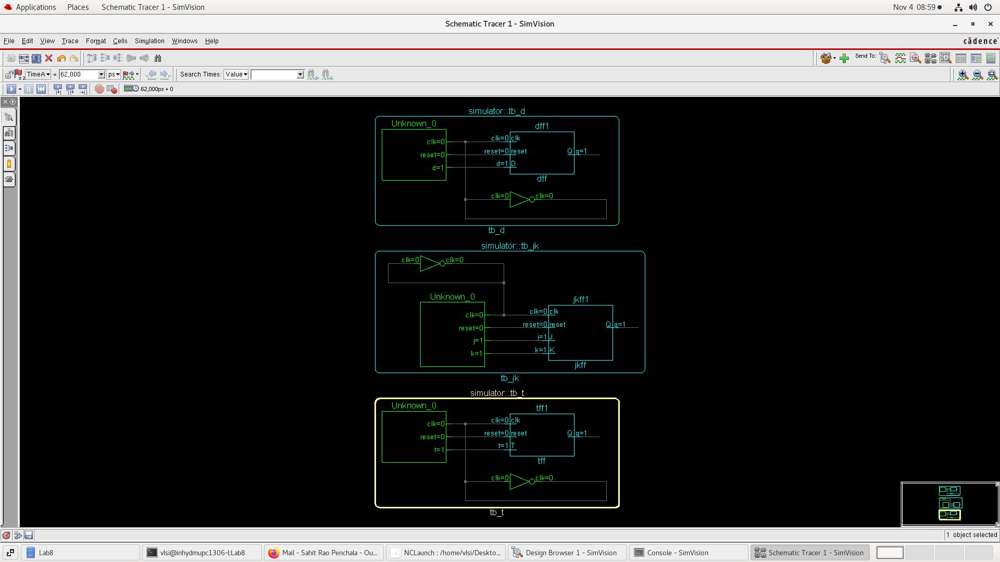
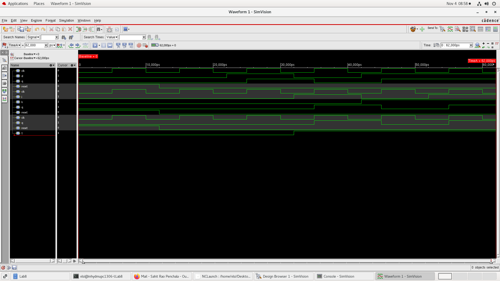

# Lab 8 — Flip-Flops Using Verilog HDL

## Objective

To design and simulate different types of edge-triggered flip-flops using Verilog HDL and verify their functionality through testbenches.

The following flip-flops are implemented:

- D Flip-Flop (DFF)
- JK Flip-Flop (JKFF)
- T Flip-Flop (TFF)

## Theory

### 1. D Flip-Flop

A D Flip-Flop stores the value present at its D input on the active clock edge. The stored value is reflected at the output Q.

**Characteristic Equation:**

\[
Q_{next}=D
\]

### 2. JK Flip-Flop

A JK Flip-Flop is an improved SR Flip-Flop that eliminates the invalid input condition.

| J | K | Operation |
|---|---|---|
| 0 | 0 | No Change |
| 0 | 1 | Reset |
| 1 | 0 | Set |
| 1 | 1 | Toggle |

**Characteristic Equation:**

\[
Q_{next}=J\overline{Q}+\overline{K}Q
\]

### 3. T Flip-Flop

A T Flip-Flop toggles its output when T = 1 and retains its previous state when T = 0.

| T | Operation |
|---|---|
| 0 | No Change |
| 1 | Toggle |

**Characteristic Equation:**

\[
Q_{next}=T\oplus Q
\]

All three designs include an active-high asynchronous reset intended to initialize the output to logic 0.

## Project Structure

```text
Lab-8/
│
├── README.md
│
├── dff.v
├── jkff.v
├── tff.v
│
├── tb_dff.v
├── tb_jkff.v
├── tb_tff.v
│
└── Images/
    ├── FlipFlops_Schematic.png
    └── FlipFlops_Waveform.png
```

## File Descriptions

| File | Description |
|---|---|
| `dff.v` | D Flip-Flop implementation |
| `jkff.v` | JK Flip-Flop implementation |
| `tff.v` | T Flip-Flop implementation |
| `tb_dff.v` | D Flip-Flop testbench |
| `tb_jkff.v` | JK Flip-Flop testbench |
| `tb_tff.v` | T Flip-Flop testbench |

## Simulation and Verification

The designs were simulated using **Cadence NCLaunch and SimVision**.

Each flip-flop was instantiated in its respective testbench. Clock signals were generated with a 10 ns period, and different input combinations were applied to verify the output behavior.

### Schematic

The following schematic illustrates the D, JK, and T Flip-Flop implementations and their respective testbench connections.



### Simulation Waveform

The SimVision waveform demonstrates the behavior of the clock, reset, input signals, and corresponding outputs for all three flip-flops.



## Results and Observations

- The D Flip-Flop stores the input D at the active clock edge.
- The JK Flip-Flop performs hold, reset, set, and toggle operations depending on J and K.
- The T Flip-Flop retains its state when T = 0 and toggles when T = 1.
- The reset signal initializes the outputs to logic 0.
- Simulation waveforms were used to verify the expected sequential behavior.

## Tools Used

- **HDL:** Verilog
- **Simulation:** Cadence NCLaunch
- **Waveform Analysis:** Cadence SimVision

## Conclusion

Successfully designed and simulated D, JK, and T Flip-Flops using Verilog HDL. The functionality of each flip-flop was verified through individual testbenches and simulation waveforms, demonstrating the fundamental behavior of sequential digital circuits.

---

**Author:** Divyesh  
**Course:** Digital System Design (DSD)  
**Lab:** 8
